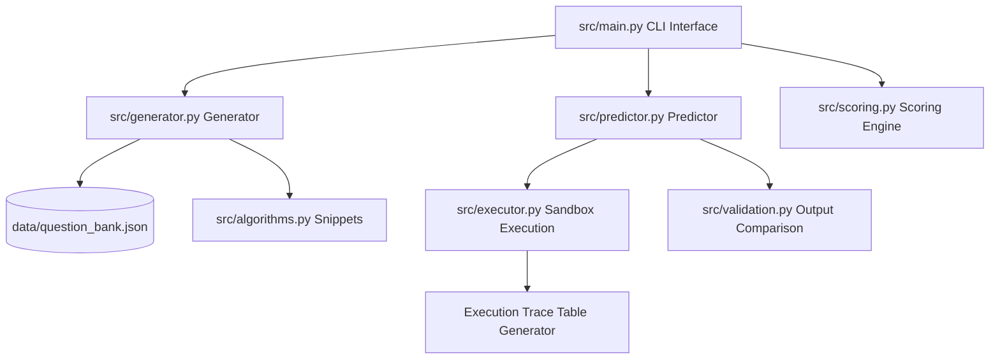
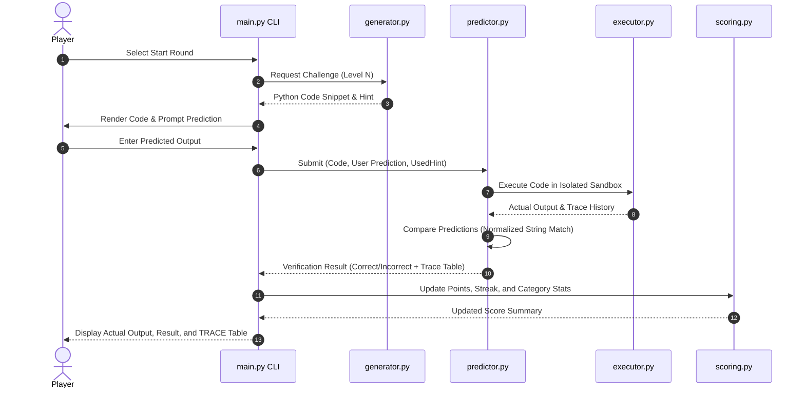

# RUNPREDICT Architecture & System Design

This document details the modular architecture and state machine of **RUNPREDICT**.

---

## 1. Modular Architecture Diagram

---

## 2. Prediction Lifecycle Sequence

